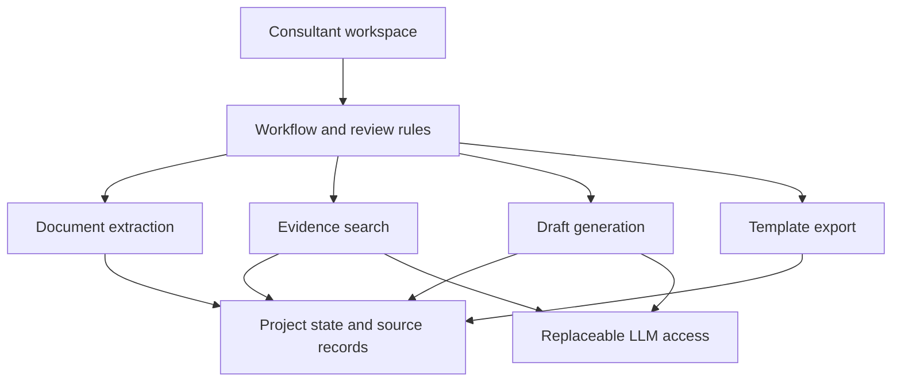

# Mesakumo: From Tender to Proposal — Product and Delivery Plan

## 1. How to use this document

This is the shared requirements, design and progress document for the hackathon prototype. Product discovery and decisions happen in this chat; implementation happens separately in Codex. Update this document when a decision changes so implementation has one current reference.

- `[CONFIRMED]`: stated in the published challenge or explicitly requested by the author.
- `[AGREED]`: a direction accepted in this discussion.
- `[ASSUMPTION]`: a planning premise that needs verification with Mesakumo.
- `[PROPOSED]`: a recommendation in this document, not yet an agreed requirement.
- `[OPEN]`: a decision or fact still needed.

Use task checkboxes in section 15. Mark a task complete only when its stated result can be inspected. Record an owner and evidence link when work starts or finishes. A plan, mockup or simulated response does not establish that functionality works.

Suggested progress note: `T23 — In progress — Owner: … — Evidence/blocker: …`.

## 2. Evidence, brief and boundaries

### 2.2 Confirmed and agreed direction

| ID | Status | Requirement or direction |
| --- | --- | --- |
| C01 | CONFIRMED | Extract requirements from the supplied tender material. |
| C02 | CONFIRMED | Match relevant company capabilities and reference projects. |
| C03 | CONFIRMED | Draft proposal sections with source references. |
| C04 | CONFIRMED | Identify missing information. |
| C05 | CONFIRMED | Let a person correct and approve output. |
| C06 | CONFIRMED | Produce a proposal using Mesakumo's supplied corporate design. |
| C07 | CONFIRMED | Demonstrate the workflow and how it supports coverage and review. |
| A01 | AGREED | Start with an already selected tender and one consultant preparing its response. |
| A02 | AGREED | Prioritise practical work, understandable review and an achievable demonstration. |
| A03 | AGREED | Keep the design adaptable until the actual documents are available. |
| A04 | CONFIRMED | Create detailed documentation and task checklists before implementation. |

The author accepted the suggested starting view. Detailed scope and architecture below remain proposals until accepted or validated against the supplied materials.

### 2.3 Working assumptions

| ID | Assumption | Consequence if wrong |
| --- | --- | --- |
| H01 | One user and one active tender are sufficient for the demo. | Revisit project isolation and collaboration if simultaneous use is necessary. |
| H02 | We can select a manageable tender with extractable text. | Scans or difficult tables may require OCR, manual transcription or a smaller scope. |
| H03 | Company material contains usable evidence for at least some requirements. | Demonstrate gaps honestly; do not invent successful matches. |
| H04 | The template has an editable, practical format. | Choose the export route only after inspecting it. |
| H05 | The demo can focus on the narrative proposal and references. | Add pricing, staffing or required forms only if central to the supplied tender. |
| H06 | Supplied LLM access can be used during the event. | Keep provider access replaceable and prepare a labelled saved-run fallback. |
| H07 | A local single-user prototype is acceptable. | Confirm any hosting, privacy and presentation requirements at kickoff. |

## 3. User, problem and product outcome

### 3.1 Primary user and job

[ASSUMPTION] The primary user is a consultant who understands company delivery capabilities but must gather evidence from several documents and obtain colleague input for commitments.

Their job is to turn a selected tender into a coherent response while knowing:

1. What the buyer requires and where it is stated.
2. What the company can substantiate with available evidence.
3. What response is being proposed and which decisions remain human responsibilities.
4. What still needs an answer before approval.

### 3.2 Three pain-point hypotheses

| Hypothesis | Example failure | Intended improvement |
| --- | --- | --- |
| Requirements are scattered and easy to miss. | An attachment requires two recent references, while the draft mentions only one. | A correctable requirement checklist with source locations. |
| Finding evidence takes time and similarity can be mistaken for proof. | A project mentions AI but does not establish the specific requested delivery experience. | Show actual supporting excerpts, qualification limits and missing evidence. |
| Fluent drafts hide unresolved facts and promises. | A suggested delivery date appears as a confirmed commitment. | Separate evidence, proposed approach and unresolved commitments during review. |

These hypotheses need a short walkthrough with Mesakumo; they are not measured findings about the company.

## 4. Inputs and outputs

| Input | What we need from it | Handling decision |
| --- | --- | --- |
| Tender and attachments | Requirements, deadlines, submission instructions, requested structure and evidence conditions | Treat uploaded files as a document set; show included and excluded files. |
| Company knowledge base | Capabilities, methods, credentials and relevant facts | Preserve document identity and available date/version metadata. |
| Reference projects | Scope, role, dates, outcomes and client details where permitted | Match against the actual requirement; flag missing qualifying details. |
| Reusable text modules | Existing wording and approved descriptions | Reuse selectively; verify any embedded factual claims. |
| Corporate template | Branding, styles, section structure, headers and footers | Inspect first; map reviewed sections into supported template locations. |
| Consultant input | Corrections, decisions and newly confirmed information | Record as human-supplied information with provenance. |

Outputs should include a requirement checklist, evidence matches, a gap list, editable proposal sections, approval state and a branded editable proposal file. An internal review appendix or separate report should retain requirement-to-section links and source details. Final formats and the placement of citations need company confirmation.

Distinguish the proposal document from the entire submission package. A narrative proposal alone may not include required forms, declarations or attachments. Track those as obligations even if their generation is outside the prototype.

## 5. Main user journey and screens

Use a guided workspace with four stages. Users can return to earlier stages; changes invalidate affected downstream review states.

| Stage / screen | Consultant sees | Main actions | Exit condition |
| --- | --- | --- | --- |
| 1. Documents | Tender set, company sources, template, processing status and unreadable items | Add/remove files, identify document roles, confirm demo scope | Supported content is available; exclusions are visible. |
| 2. Requirements and evidence | Requirement list, source excerpt, proposed classification and matched company evidence | Correct/add/split requirements, inspect sources, accept/reject matches | Extraction has been reviewed and gaps are visible. |
| 3. Draft and resolve | Proposal outline, editable section, linked requirements, evidence and open issues | Generate/revise a section, edit text, supply facts, resolve questions | Sections are reviewed or explicitly remain open. |
| 4. Review and export | Coverage summary, unresolved blockers, review status and export preview | Inspect issues, approve a specific version, export draft or approved document | Export status matches the reviewed version. |

### 5.1 Screen design principles

- Keep requirement text, relevant evidence and the response close together. A reviewer should not need to copy an identifier into another screen to verify it.
- Use a list or narrow navigation column on the left, selected content in the centre and source/issue detail on the right when space allows. Collapse the source panel on smaller screens.
- Show plain status labels with colour as a secondary cue: `Unreviewed`, `Needs information`, `Reviewed`, `Approved`.
- Keep three meanings separate: requirement classification, evidence adequacy and review status. A reviewed requirement can still have insufficient evidence.
- Source links should open the exact excerpt and its document location. Full PDF highlighting is useful if time allows; an accurate excerpt with page/heading is enough for the first version.
- Avoid decorative dashboards, animated agent activity and percentages that imply unverified completeness.

### 5.2 Example review interaction

The requirement asks for a comparable project completed within a stated period. The system proposes a relevant project, but its completion date is absent. The reviewer sees the supporting scope excerpt and a visible `Completion date missing` issue. They reject the suggestion or add a verified date with its source. The draft changes only after that decision and the affected section requires review again.

## 6. Requirements, automation and human responsibility

### 6.1 Requirement record

Each extracted requirement should have a stable ID, concise statement, original excerpt, document and location, proposed type, importance if explicit, linked evidence, response section and open issues. Capture numerical constraints, dates and qualifications without weakening them.

Suggested types: deliverable, capability/eligibility, reference evidence, submission instruction, deadline, evaluation criterion and other. Classification is a suggestion until reviewed. Do not infer that a condition is optional merely because it lacks the word “must”. Use `Unclear` when needed.

Do not reduce a compound obligation to a vague summary. Split it into checkable items where useful while preserving the shared source. Merge duplicates carefully and retain all relevant source locations. Keep contradictory requirements visible until a person resolves the interpretation.

### 6.2 Responsibility boundaries

| Activity | App should automate | App should suggest | Person controls |
| --- | --- | --- | --- |
| Requirement extraction | Produce candidate items and source links | Type, grouping and possible duplicates | Correct wording, importance and completeness review |
| Evidence search | Retrieve candidate excerpts | Relevance and limitations | Whether evidence is sufficient and permitted for reuse |
| Drafting | Assemble a first response from selected context | Approach, wording and structure | Claims, commitments, tone and final content |
| Gap handling | Detect missing fields and unsupported claims where possible | A targeted question and affected section | Answer, evidence, escalation or deliberate non-response |
| Approval | Check recorded blockers and version consistency | What needs attention next | Approval, rejection and withdrawal |
| Export | Populate the template from the selected draft version | Formatting warnings | Document inspection and use outside the app |

### 6.3 Handling imperfect information

| Situation | Required behaviour | Reviewer option |
| --- | --- | --- |
| No supporting evidence retrieved | Say “No evidence found in the supplied material”; do not conclude the company lacks the capability. | Add a source, supply a fact or leave unresolved. |
| Evidence only partly supports a requirement | Identify which condition is supported and which is missing. | Choose another reference or confirm missing detail. |
| Conflicting sources | Display both excerpts and available dates; do not silently pick one. | Choose the authoritative source and record the reason. |
| Possibly outdated information | Show available dates and flag requirements with explicit recency conditions. An old date alone does not invalidate a source. | Confirm currency or replace the evidence. |
| Unsupported factual claim in a draft | Flag the claim and its absent/insufficient support. Automated checks assist review and cannot guarantee all unsupported claims are found. | Remove, revise or attach evidence. |
| Proposed method or future approach | Label it as a proposal; do not disguise it as past experience or an approved commitment. | Edit and approve the proposed approach. |
| Missing availability, price or delivery commitment | Use an explicit unresolved issue; no invented value. | Supply an authorised answer. |
| User-supplied fact | Retain who supplied it, when and any source/note; distinguish confirmation from documentary proof. | Approve with recorded basis or request evidence. |
| Unreadable or unsupported document | Report the failure and exclude it visibly from analysis. | Replace, transcribe or narrow the declared scope. |
| Instructions embedded inside source documents | Treat them as content to analyse, not permission to change application rules or perform actions. | Inspect suspicious content if relevant. |

### 6.4 Review and approval rules

[PROPOSED] Extraction review, evidence selection, section review and final approval are distinct actions. Do not add a confirmation dialog after every minor edit; use clear stage-level review and visible changes.

- A requirement is “addressed in draft” only when linked to an actual response passage; this does not mean it is satisfied.
- A factual claim is source-supported only to the extent the excerpt supports that claim. A valid document ID alone is insufficient.
- Requirement coverage uses the reviewed checklist as its denominator; it does not prove nothing was missed during extraction.
- An open blocker prevents the `Approved` state. A draft export remains available and is clearly labelled.
- Nonblocking issues can be accepted with a visible reviewer note. Classifying an issue as nonblocking is an explicit human decision.
- Final approval applies to a version of the draft, source set and requirement checklist. Editing content, changing selected evidence or regenerating a section invalidates affected review and final approval.
- Exporting an approved file uses that exact approved version. A later edit creates a new draft; it must not change an already approved export silently.
- Approval is preparation for human use; the application does not submit the tender or certify legal compliance.

## 7. Prioritised feature scope

### 7.1 Must-have: complete one credible workflow

| ID | Feature / flow | Minimum acceptable behaviour |
| --- | --- | --- |
| M01 | Load a selected tender set and company sources | Supported demo formats work; processing failures are visible. |
| M02 | Extract and correct requirements | Stable IDs, source excerpts/locations and editable classifications. |
| M03 | Match capabilities and reference projects | Show supporting passages; allow acceptance, rejection and no-match outcomes. |
| M04 | Identify and resolve gaps | Link missing information to requirements or claims; capture human answers. |
| M05 | Generate editable proposal sections | Use selected sources and requirements; preserve factual source links. |
| M06 | Review coverage and content | Navigate from a requirement to response and evidence; inspect open issues. |
| M07 | Approve a specific version | Block unresolved blockers and invalidate approval after relevant changes. |
| M08 | Export in supplied corporate design | Generate an editable branded review document with correct status and no silent truncation. |
| M09 | Save and resume | A refresh/restart preserves work, corrections and review state in the demo environment. |
| M10 | Reliable end-to-end demonstration | One actual run, including correction and gap handling, produces a reviewable document. |

### 7.2 Useful if time remains

Prioritise only after the must-have path works: exact PDF highlighting; change preview before regeneration; richer reference comparisons; page/word-limit warnings where stated; direct editing of a proposed outline; export to PDF alongside the editable file; a separate review report; manually assigning an issue owner; basic duplicate merging assistance; recorded processing times for measured examples.

Conflict visibility, date visibility and source excerpts remain must-have behaviours. Sophisticated automatic conflict detection, automatic freshness reasoning and bulk document processing are extensions.

### 7.3 Later

Multi-user roles and collaboration; integrations with company repositories and CRM; version comparison across tender amendments; OCR for difficult scans; richer tables/forms handling; multilingual production workflows; automated document permissions; reusable organisational approval policies; large-scale search; background jobs; deployment, monitoring and enterprise security; submission-package assembly.

### 7.4 Scope-cut order

If behind schedule, remove visual polish, optional PDF export, advanced source highlighting, broad file-format support, automatic conflict detection and bulk processing first. Narrow the input to an agreed supported tender and a small knowledge set. Never present an omitted attachment as analysed.

Preserve requirement traceability, honest gaps, human correction, version-aware approval and the corporate-design export. If only selected tender sections can be demonstrated, declare that limitation and do not call the result a complete tender response.

## 8. Proposed architecture: simple now, expandable later

### 8.1 Design decision

[PROPOSED] Use one application with separate internal modules and explicit workflow state. Separate content processing from the user interface and document formatting. This supports future changes without requiring microservices, autonomous agents or cloud infrastructure.

This diagram describes responsibilities, not separate deployed services. LLM-assisted extraction may also use the same access module where useful. Deterministic application rules own review states and export eligibility.

### 8.2 Module responsibilities

| Module | Owns | Future expansion |
| --- | --- | --- |
| Document adapters | Format-specific text/structure extraction and location mapping | OCR, additional formats, richer tables |
| Source store | Original documents, stable IDs, excerpts, dates and versions | Managed repository connectors |
| Requirement service | Candidate extraction, edits and links to tender excerpts | Amendment comparison, richer classification |
| Evidence search | Candidate retrieval, excerpts and match qualifications | Alternative retrieval/ranking methods |
| Draft service | Outline, section generation and structured claim/source associations | More section types and language support |
| Review service | Issues, decisions, version dependencies and approval | Company policies and multiple reviewers |
| Export adapter | Map approved/draft content to a template and build a file | Additional templates and output formats |
| LLM access | Provider calls, timeouts, response validation and bounded retries | Alternative supplied providers |
| Persistence | Project state, revisions, run metadata and local artifacts | Shared storage and collaboration |

### 8.3 Minimal information model

| Record | Essential fields |
| --- | --- |
| Project | ID, tender name, document IDs, current revision, scope notes |
| Document | ID, role, filename, content hash/version, available date, processing status |
| Source passage | ID, document version, page/heading/table location, exact extracted excerpt |
| Requirement | ID, statement, type, source passage IDs, human classification, review state |
| Evidence match | Requirement ID, passage IDs, supported conditions, limitations, reviewer decision |
| Proposal section | ID, title, text, revision, requirement IDs, claim/source associations, review state |
| Issue | ID, affected requirement/section/claim, category, severity, question, answer, resolution basis |
| Review decision | Target ID and revision, reviewer label, timestamp, decision and note |
| Export | ID, project snapshot/revision, template version, status, file location and creation time |

Claim associations need to survive edits. For the prototype, use stable claim/paragraph IDs where feasible; if an edit breaks the association, mark it unverified and require review. Do not retain a stale source badge merely because text remains in the same section.

### 8.4 Processing sequence and state

1. Register documents and extract text with locations; store processing failures.
2. Generate requirement candidates in a validated structure; reject unknown source IDs.
3. Let the reviewer correct the checklist before relying on coverage summaries.
4. Retrieve evidence for each requirement and present qualifications and gaps.
5. Generate sections from the reviewed requirements and selected evidence.
6. Validate returned source IDs, identify explicit missing values and create review issues.
7. Let the person edit, resolve issues and review affected sections.
8. Run approval rules and record the exact approved snapshot.
9. Render that snapshot through the template adapter; check the generated file.

Project states: `Documents ready`, `Requirements reviewed`, `Draft in progress`, `Ready for final review`, `Approved`. These describe readiness; users can go back. The system must recompute affected readiness after changes instead of trusting the last selected stage.

### 8.5 Technology decisions to defer until inspection

Python is a reasonable starting choice given the author's experience, but the final framework, parsing libraries, storage and output libraries are not requirements. A simple Python UI with local durable state may be enough. Select the document library based on the actual corporate template. Select retrieval based on knowledge-base size and file structure; a separate vector database is not automatically necessary.

Use the supplied LLM access through one replaceable interface. Check its actual configuration, structured-output support, response limits and failure behaviour at kickoff. No outside infrastructure should be added just to make the diagram more elaborate.

### 8.6 Practical safeguards

Keep credentials outside documents and source control. Use only permitted data and supplied/approved model access. Confirm whether project/client names may appear in the pitch. Bound retries, preserve user edits and show failures without presenting partial output as complete. Keep source content separate from application instructions. Provide a project reset and avoid displaying credentials in logs or during the presentation.

## 9. Acceptance criteria and definition of done

These are proposed prototype targets. They become evidence of success only after tests run. A manually reviewed demo checklist is a reference for the selected scenario, not a general accuracy benchmark.

| ID | Acceptance criterion | Verification |
| --- | --- | --- |
| AC01 | All files in the selected set have an explicit processing outcome. | Include one unsupported/unreadable test input; verify a visible failure. |
| AC02 | Every requirement in the reviewed demo checklist has a working tender source location. | Inspect each link against the original; include all mandatory items identified in the manual checklist. |
| AC03 | Constraint details survive extraction. | Check selected numbers, dates, quantities and recency conditions verbatim against the source. |
| AC04 | An accepted evidence match supports the stated conditions or visibly records remaining gaps. | Inspect positive, partial and no-match examples. |
| AC05 | Every factual capability/reference claim in the demo draft has adequate evidence or an unresolved issue. | Manually inspect the full demo draft, not just whether citations exist. |
| AC06 | A missing commitment is not invented. | Remove a required fact and verify the gap appears in review and draft export. |
| AC07 | A reviewer can correct a requirement, reject a match and edit a section. | Run those actions and verify persistence. |
| AC08 | Requirement-to-section navigation works and unaddressed requirements stay visible. | Select a requirement with and without a draft response. |
| AC09 | Unresolved blockers prevent final approval; draft export remains clearly labelled. | Attempt approval before and after resolution. |
| AC10 | A relevant edit invalidates approval; approved export uses its recorded snapshot. | Approve, edit and export both appropriate versions; inspect their states/content. |
| AC11 | Corporate-design output preserves supplied branding and all selected content. | Open the file in the intended editor; inspect styles, tables, page breaks and placeholders. |
| AC12 | Work survives refresh/restart, and an LLM failure does not erase edits. | Save edits, restart and simulate a failed call. |
| AC13 | The full selected journey can be shown within the pitch allocation. | Rehearse with a stopwatch after confirming the allocation. |
| AC14 | Evidence status and review status are visually distinct. | Verify an approved human judgement cannot silently turn missing evidence into documentary proof. |

Definition of done: all must-have tasks have inspectable evidence; AC01–AC14 pass for the declared demo scope; known limitations are documented; the output file opens correctly; a rehearsal has completed; no claim of measured improvement exceeds the evidence collected.

## 10. Test plan

### 10.1 Test materials

Create a small permission-safe fixture set with a manually checked tender checklist, a strong reference, a partial reference, an irrelevant reference, a missing fact, a conflicting fact, an explicitly outdated credential where a tender recency rule applies, and one unsupported file. Artificial fixtures must be labelled synthetic. Use actual supplied material for the final demo wherever feasible and permitted; do not modify source documents to manufacture a successful match.

### 10.2 Checks by layer

| Layer | What to test | Minimum evidence |
| --- | --- | --- |
| Extraction | Supported file parsing, source locations, tables used in the scenario, dates/numbers and failure handling | Reviewed checklist and parser fixture results |
| Evidence | Correct passage, partial support, no support, conflicting versions and date constraints | Small labelled examples with expected outcomes |
| Drafting | Correct requirement use, supported claims, explicit missing facts and invalid source IDs | Saved outputs with manual annotations |
| Workflow | Corrections, issue resolution, approval gating, invalidation and persistence | Automated tests for state rules plus one manual journey |
| Export | Template styles, complete content, placeholders, citation placement and document status | Opened exported draft and approved file |
| Resilience | Timeout, malformed model output, restart and repeat generation | Recorded failure cases without lost edits |
| Usability | Can another person find a claim's source and identify the next action? | Short observed walkthrough and corrections made |

Prioritise automated tests for version/approval rules, source-ID validation, gap propagation and export completeness. Do not spend the event testing decorative elements. Review LLM output semantically: structural validation cannot establish that a passage supports a claim. Test at least two actual generation runs if access permits, because one good answer does not establish repeatability.

### 10.3 Lightweight evaluation

For the selected scenario, record manually verified mandatory-requirement recovery, number of draft claims checked and unsupported claims found, unresolved issues, export success and elapsed workflow time. Report raw counts and the scenario scope. Do not claim general accuracy, time savings or bid-winning impact without an appropriate baseline and sufficient evaluation.

## 11. Small end-to-end demo scenario

### 11.1 Illustrative scenario, not a real Mesakumo tender

A public organisation requests a workshop and prototype for a document-based knowledge assistant. The tender asks for a delivery approach, comparable references and a delivery schedule. A possible supplied reference supports relevant experience but has no completion date; another source supports the company's workshop approach. Staff availability is not documented.

Replace this example with the selected supplied tender after inspection. Do not present these details as Mesakumo facts.

### 11.2 Demonstration actions

1. Open the loaded tender set and show the declared processing scope.
2. Select an extracted requirement and open its exact source excerpt.
3. Inspect a suggested reference. Show what it supports and the missing date condition.
4. Reject an unsuitable match or correct an extraction; show the corrected state.
5. Generate or open proposal sections with linked requirements and source evidence.
6. Show an unresolved availability question. Attempt final approval and show why it is blocked.
7. Enter a verified answer with its basis, or explicitly keep the proposal as a draft if no answer is available. Never fabricate a resolution for the live pitch.
8. Review and approve the updated version when blockers are genuinely resolved.
9. Export and open the branded document, including the reviewed response and correct status.

If the final pitch is five minutes, a proposed allocation is: 30 seconds for the consultant problem, 60 seconds for tender-to-evidence, 90 seconds for drafting and correction, 60 seconds for the gap/approval interaction and 60 seconds for the document and limitations. Adjust after confirming the actual pitch duration.

### 11.3 What should make the demo persuasive

- One clear story with a visible beginning, decision and usable output.
- An honest failure case and a meaningful human correction.
- Evidence opened during the demonstration rather than merely asserted.
- A document the consultant can inspect and continue editing.
- A concise explanation of what is tested, what remains limited and what company feedback would change next.

### 11.4 Fallback

Prepare an allowed saved project state and a previously generated document. If live LLM access fails, disclose that the generation was saved earlier, then demonstrate real review, correction, state changes and export if available. Keep screenshots/video only as a final presentation fallback. Do not portray replayed model output as a live call.

## 12. Questions for Mesakumo

Resolve the first six before locking implementation choices.

1. Which supplied tender and subset best represent the challenge and fit the demonstration?
2. What file formats, attachment types and languages must work for that scenario?
3. What does an acceptable proposal look like: narrative, prescribed forms, pricing, staffing and attachments?
4. What is the corporate template format, and where should internal citations and review notes appear?
5. Which facts require colleague confirmation, and what should prevent approval?
6. What usage restrictions apply to source documents, client names, model access and the final pitch?
7. Can someone walk us through their current tender workflow and the most expensive review step?
8. Which sources are authoritative when company documents conflict? Are dates/versions available?
9. What makes a reference project acceptable, including recency, scope and permission to name the client?
10. Should proposed approaches be reviewed differently from claims about past experience?
11. Is a local demo acceptable? What connection and presentation setup will be available?
12. What are the actual judging criteria and final pitch duration?

## 13. Delivery strategy and effort budget

[PROPOSED] Plan approximately 14–17 focused implementation/review hours within the event, leaving time for company discussions, breaks, integration failures and pitching. These are rough planning budgets, not measured estimates or a promise. Team size and actual file complexity will change them. Frontend and document complexity must not consume the time needed for the complete workflow.

| Milestone | Budget | Result needed before continuing |
| --- | --- | --- |
| P0 — Discover and freeze the demo | 1–1.5 h | Selected materials, output target, constraints and manual checklist |
| P1 — Prove export and state first | 1.5–2 h | A template-based file with sample content and persisted project state |
| P2 — Requirements and evidence | 3–4 h | Correctable sourced checklist and useful evidence matches |
| P3 — Draft, gaps and approval | 3–4 h | Editable sections, honest issues and working review rules |
| P4 — Integration and verification | 2.5–3 h | Full journey, restart and failure tests, inspected exports |
| P5 — Rehearsal and pitch | 2–2.5 h | Rehearsed story, fallback and documented limitations |

These phase ranges total 13.5–17 hours. Aim for the complete workflow by Saturday late morning. Use the published 13:30 pitch-review slot as a checkpoint, subject to organiser confirmation. Stop adding features before rehearsal; keep the final period for fixes and presentation. If behind, apply section 7.4 immediately.

Dependency order: understand inputs and template → prove a minimal export → build sourced requirements → match evidence → draft and resolve issues → review/approve/export → verify and rehearse. Finish one complete path before expanding input breadth.

## 14. Risks and decisions

| Risk | Early signal | Response |
| --- | --- | --- |
| Template integration is harder than expected | Unsupported format, complex tables or embedded assets | Prove a simple export before the full UI; agree supported sections. |
| Tender parsing loses essential information | Missing table rows or inaccurate source locations | Inspect early, support manual correction and narrow declared input scope. |
| Knowledge base does not substantiate claims | Many partial/no-match results | Treat this as a review outcome; demonstrate gaps rather than fabricate evidence. |
| Model responses vary or fail | Invalid structures, timeouts or changed references | Validate IDs, bound retries, preserve prior state and use labelled fallback. |
| Review feels cumbersome | Too many approvals or excessive navigation | Keep source/context visible and use stage/section-level actions. |
| Scope grows beyond the event | Additional dashboards, integrations or formats before export works | Enforce must-have milestones and scope-cut order. |
| Demonstration implies more than was tested | Claims of full compliance or generic accuracy | State scenario boundaries and show measured evidence only. |

### Decision log

| ID | Date | Decision / proposal | Status and revisit trigger |
| --- | --- | --- | --- |
| D01 | 2026-11-20 | Start with a selected tender and one consultant. | AGREED; revisit only if company use case requires otherwise. |
| D02 | 2026-11-20 | Document first and track work through checklists. | AGREED. |
| D03 | 2026-11-20 | One modular application; technology chosen after file inspection. | PROPOSED; validate at P0. |
| D04 | 2026-11-20 | Allow labelled draft export; block final approval on unresolved blockers. | PROPOSED; validate with company reviewer. |
| D05 | 2026-11-20 | Keep internal traceability even if citations are omitted from the external proposal. | PROPOSED; validate template and review expectations. |
| D06 | 2026-11-20 | Prefer one complete workflow over broad input support. | PROPOSED; validate selected demo materials. |

## 15. Task checklist and progress tracker

Implementation checkboxes reflect verified results; partial foundation work is detailed in section 17. Documentation work is recorded separately so it is not confused with product delivery. Task IDs are stable; add new tasks without renumbering existing ones. A blocked task stays unchecked and receives a blocker note.

### Documentation completed in this turn

- [x] DOC01 — Record the verified brief, assumptions and boundaries.
- [x] DOC02 — Propose user journey, feature priorities and review behaviour.
- [x] DOC03 — Propose architecture, information model and extension points.
- [x] DOC04 — Define acceptance criteria, test plan and demo scenario.
- [x] DOC05 — Create a sequenced task tracker and delivery budget.

### P0 — Discovery and scope lock

- [ ] T01 — Recheck the current brief, schedule, judging criteria and pitch duration. Done: confirmed notes recorded.
- [ ] T02 — Inventory supplied tenders, attachments, company sources and template. Done: file roles, formats and permissions recorded.
- [ ] T03 — Walk through a consultant's current process with Mesakumo. Done: top pain point and review expectations recorded.
- [ ] T04 — Choose one demo tender and declare included/excluded material. Done: scenario scope accepted by the team/company contact.
- [ ] T05 — Manually read the selected tender and build a reference checklist. Done: mandatory items, constraints and locations recorded.
- [ ] T06 — Inspect company sources and identify usable, partial and missing evidence. Done: initial evidence examples selected.
- [ ] T07 — Confirm output format, template fields and citation placement. Done: an example desired output is understood.
- [ ] T08 — Confirm model access and data-use restrictions. Done: permitted access works without exposing credentials.
- [ ] T09 — Accept or revise proposed scope and approval rules. Done: decision log updated and optional work separated.

### P1 — Foundations and early export proof

- [ ] T10 — Choose the smallest practical stack after T02/T07/T08. Done: one short decision with alternatives/trade-off recorded.
- [x] T11 — Create application structure and configuration. Done: app starts with no embedded secrets.
- [x] T12 — Define project, document, requirement, evidence, section, issue and approval records. Done: state can represent the demo.
- [x] T13 — Implement save/load and revision identifiers. Done: a sample project survives restart.
- [ ] T14 — Implement a minimal template export with sample content. Done: branded editable document opens in the intended editor.
- [ ] T15 — Define source IDs and location mapping. Done: sample excerpts resolve to their original locations.
- [ ] T16 — Add replaceable LLM access with clear failures and bounded retries. Done: successful and failed calls are distinguishable.

### P2 — Document understanding and evidence

- [x] T17 — Implement supported tender/knowledge parsing. Done: included demo files have explicit processing outcomes.
- [x] T18 — Show document roles, processing status and excluded material. Done: AC01 is inspectable.
- [x] T19 — Extract structured requirement candidates with source links. Done: no invented document/passage IDs are accepted.
- [x] T20 — Add requirement correction, manual addition and classification. Done: reviewer changes persist with provenance.
- [x] T21 — Add extraction-review state. Done: coverage is based on the reviewed checklist.
- [ ] T22 — Compare extraction with the manual checklist. Done: missing/incorrect mandatory items corrected and counts recorded.
- [ ] T23 — Retrieve candidate capability/reference evidence. Done: strong, partial and no-match examples are visible.
- [ ] T24 — Show excerpts, dates when available and match limitations. Done: reviewer can assess actual support.
- [ ] T25 — Accept/reject evidence matches. Done: decisions persist and drive drafting context.
- [ ] T26 — Record missing/conflicting information as linked issues. Done: each issue has an affected item and actionable question.

### P3 — Drafting, review and document output

- [ ] T27 — Map reviewed requirements to the proposal outline. Done: every in-scope requirement has a response destination or visible gap.
- [ ] T28 — Generate sections using selected evidence. Done: factual claims have source associations or open issues.
- [ ] T29 — Validate returned structures and source IDs. Done: malformed/unknown references cannot appear as valid evidence.
- [ ] T30 — Add editable sections while preserving or invalidating claim associations correctly. Done: stale source badges are removed/flagged.
- [ ] T31 — Add human answers and resolution basis to issues. Done: supplied facts remain distinguishable from documentary evidence.
- [ ] T32 — Build coverage and open-issue review views. Done: requirement → response → source navigation works.
- [ ] T33 — Add section review and final approval gating. Done: unresolved blockers prevent approval.
- [ ] T34 — Invalidate affected review/approval after edits or evidence changes. Done: an old approval cannot authorise new content.
- [ ] T35 — Create export snapshots with template/version metadata. Done: approved export corresponds to the recorded snapshot.
- [ ] T36 — Populate the corporate template with real demo content. Done: selected content and required structure appear completely.
- [ ] T37 — Support labelled draft export and approved export. Done: unresolved issues/status are handled as agreed with Mesakumo.
- [ ] T38 — Open and inspect exported files. Done: no unresolved template placeholders, clipped content or accidental internal notes.

### P4 — Testing and integration

- [ ] T39 — Prepare the small positive/negative fixture set. Done: synthetic and real material are clearly distinguished.
- [ ] T40 — Test extraction details and original source locations. Done: AC02/AC03 results recorded.
- [ ] T41 — Test strong, partial, absent, conflicting and recency-constrained evidence. Done: expected review outcomes observed.
- [ ] T42 — Inspect demo draft claims against evidence. Done: AC05/AC06 findings recorded and unsupported claims corrected/flagged.
- [ ] T43 — Automate approval, invalidation and export-snapshot tests. Done: relevant state transitions pass.
- [ ] T44 — Test refresh/restart, malformed output and model-call failures. Done: saved edits survive and failures are visible.
- [ ] T45 — Run the full flow on actual permitted demo materials. Done: inspectable output produced from declared inputs.
- [ ] T46 — Ask another person to inspect a source and resolve a gap. Done: usability findings recorded and critical confusion fixed.
- [ ] T47 — Run another generation when access permits and inspect differences. Done: repeatability limits recorded.
- [ ] T48 — Complete the AC01–AC14 review. Done: pass/fail evidence and remaining limitations recorded.

### P5 — Demo and pitch readiness

- [ ] T49 — Replace the illustrative scenario with the actual selected story. Done: no fictitious company facts remain in the pitch.
- [ ] T50 — Prepare a permission-safe starting project and labelled saved-run fallback. Done: both can be opened quickly.
- [ ] T51 — Write the pitch around problem, correction, evidence and final artifact. Done: script fits confirmed allocation.
- [ ] T52 — Rehearse end to end with a stopwatch. Done: actions and transition points fit available time.
- [ ] T53 — Check presentation setup, access and exported document on the presentation machine. Done: files open and credentials are hidden.
- [ ] T54 — Prepare evidence-based results and limitations. Done: no unsupported accuracy/time-saving claims.
- [ ] T55 — Freeze features and fix only demo blockers. Done: known-good project state retained.
- [ ] T56 — Perform final rehearsal including the fallback explanation. Done: team knows how to continue after a failed live call.

### Useful-if-time backlog — do not start before the core journey works

- [ ] U01 — Add exact PDF highlighting for source passages.
- [ ] U02 — Preview section changes before accepting regenerated text.
- [ ] U03 — Export a separate internal evidence/review report.
- [ ] U04 — Add PDF export alongside the editable branded file.
- [ ] U05 — Add explicit tender word/page-limit warnings where applicable.
- [ ] U06 — Improve reference comparison and duplicate requirement suggestions.

### Active work and blockers

| Task ID | Owner | State | Evidence or blocker | Next action |
| --- | --- | --- | --- | --- |
| T01–T09 | Unassigned | Not started | Actual supplied material and company answers not yet reviewed here. | Start P0 and update decisions. |

### Acceptance results

| Criterion | Result | Evidence / limitation |
| --- | --- | --- |
| AC01–AC14 | Full acceptance review not run | Foundation implemented; seven automated checks pass. Real-material processing and export remain unimplemented. See section 17. |

## 16. Next documentation step

Review P0 with the actual Mesakumo materials. First settle the selected tender, expected output and approval meaning. Then update assumptions and the must-have scope before finalising the implementation prompt. Do not lock parsing, retrieval or export technology before those answers.

## 17. Foundation implementation — 20 November 2026

Owner: Codex. Scope: the user's explicitly requested foundation milestone;
this does not establish completion of the broader product acceptance criteria.

[IMPLEMENTATION DECISION] Reuse existing Python 3.11.9 `.venv`; standard-library
loopback HTTP UI, dataclasses and SQLite JSON snapshots. No dependencies installed.
This is a reversible foundation choice while T02/T07/T08 remain open. Compared
with Streamlit/FastAPI, it avoids installation and framework coupling at the cost
of a basic server-rendered UI. Revisit the UI framework as actual needs emerge.

[IMPLEMENTED] Conservative version-aware manual review: open blocking issues and
unreviewed sections/checklist prevent approval. A fingerprint binds approval to
content; content edits reset section reviews. Manual free edits clear section
source associations. These are foundation rules, pending company policy validation.

| Task | State | Evidence / remaining work |
| --- | --- | --- |
| T10 | Foundation stack selected; discovery dependency outstanding | README.md and pyproject.toml; revisit after supplied formats/access inspection. |
| T11 | Complete | App entry point reaches local HTTP startup without credentials or installed packages; UI rendering verified with an in-process HTTP harness. Live port access could not be verified in this execution environment. |
| T12 | Complete | `mesakumo/domain.py`; typed records and labelled synthetic fixture. |
| T13 | Complete | SQLite round-trip through a reopened store; revisions and review history retained in tests. |
| T14–T16 | Not complete | Source fixtures and disabled adapter protocols exist; no real source mapping, live model/retries or branded export. |
| T30–T34 | Partial foundation only | Manual edit, answer, review and approval rules tested on synthetic records; real claim mapping and full coverage workflow outstanding. |
| T43–T44 | Partial | Persistence/approval tests pass; export snapshots and live model failure handling not implemented. |

Verification: seven automated checks across `tests/test_foundation.py` and `tests/test_ui.py` cover restart
round-trip, unresolved-blocker/review gates, source badge clearing, approval
invalidation on content/source edits, stale writes and unavailable adapters.
No broader AC01–AC14 pass is claimed. All unavailable UI actions explicitly say
unavailable; synthetic fixture content is hand-authored, not processed or generated.

Next small milestone: inspect one permitted tender, implement its narrow document
adapter and source locations, then enable manual requirement correction. Export
technology remains open until the corporate template is inspected.

Verification limitation: direct socket binding was sandbox-restricted. An elevated loopback connectivity check stalled and was stopped. Do not treat browser connectivity as verified here. Run locally using README commands.

HTTP handler verification: `tests/test_ui.py` passes sample creation, rendering all four stages, reopening persistence and rejecting an invalid form token using an in-process transport harness. Seven tests pass in total. This does not establish real-browser connectivity.

## 18. Documents → Requirements milestone — 20 November 2026

Status: **partial**, owner Codex. Evidence: [implementation log](IMPLEMENTATION_LOG.md#documents--requirements--20-november-2026--partial)
and [current handoff](PROJECT_STATUS.md). Section 17 is historical foundation scope;
this section supersedes its statements that parsing and requirement editing are absent.

T17–T21 are complete for the **declared supported synthetic test scope**, not for
unseen company files: TXT/PDF/DOCX extraction, visible status/errors, typed candidate
validation with actual source IDs, manual correction/add/delete/classification with
provenance, and separately recorded checklist review. Seventeen tests and a real
HTTP upload/edit/review/restart check pass. Browser automation host is unavailable.
T19 provider output validity is tested at a mocked boundary; semantic extraction
accuracy and a live model call are **not** established. T16 remains unchecked until
approved provider access has successfully been verified. T22 remains unchecked
until a live extraction can be compared with a permitted tender's manual checklist.

No T23+ evidence-retrieval, proposal-generation or template-export completion is
claimed. No AC01–AC14 full pass is claimed. Templates are stored only; no supplied
corporate template was present to inspect. Actual demo formats, permissions,
model ID and inference-region policy remain P0 questions. Input over 48 KB is
explicitly rejected without truncation; narrow and declare scope rather than imply
full-tender analysis. Failed tender versions must be replaced before review.

[IMPLEMENTATION DECISION] Keep current standard-library HTML/HTTP UI to preserve
working behaviour; add pypdf 6.21.4 and standard-library DOCX/TXT adapters. Requesty
EU connection uses official documented chat-completions contract with explicit
configuration and approval; no model ID or access is assumed.
