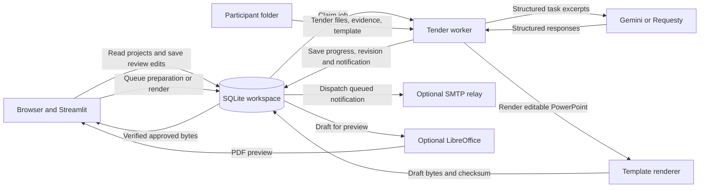

# TenderWorkbench architecture and workflow guide

TenderWorkbench turns a local tender folder into a reviewable PowerPoint proposal. **Projects** is where you select tenders and queue work. During preparation, the project shows the active stage as the worker moves through **Tender requirements**, **Evidence**, **Proposal**, and **Final review**. Once the draft is ready, you can move between those views to review the saved project. Final approval records the exact PowerPoint bytes the reviewer approved.

- [Run a tender from intake to download](#run-a-tender-from-intake-to-download)
- [Understand every screen and control](#screens-and-controls)
- [Follow the code from the launcher to the worker](#architecture-and-code)
- [Understand what gets saved and reused](#storage-revisions-and-concurrency)
- [Trace an example and diagnose a problem](#worked-example)

## Run a tender from intake to download

1. Start from the repository root with `.venv/bin/python -m mesakumo` and open `http://127.0.0.1:8501`. Configure Gemini or Requesty to prepare new material. The setup guide covers provider credentials, optional OCR, LibreOffice preview, and review email. [Setup guide](../TECHNICAL.md#macos-setup-for-the-automated-workflow) · [Environment settings](../.env.example)
2. In **Projects**, open **Local folders and language**. Choose the participant folder, which contains the tender subfolders, historical and team materials, and `Angebotstemplate.pptx`. Save the settings. A folder may produce one project or separate participation and offer projects.
3. Select a project and phase and click **Prepare proposals**. The worker saves progress in SQLite. A successful render can produce a draft with issues for a reviewer to resolve. If a run is **Partial** or **Failed**, open it and read the diagnostic before resuming.
4. In **Tender requirements**, check the cited brief, reading gaps, and requirement classification. In **Evidence**, verify that each proof criterion has appropriate support. Re-run preparation after saving changes to criteria or assessments so the worker can recompute affected content.
5. In **Proposal**, edit slide wording, cover text, and verified fields such as milestones or pricing. Use **Regenerate from saved slides** in **Final review** for edits that only require a rebuild. After marking a slide group for refresh, use the sidebar preparation action to generate it again.
6. In **Final review**, inspect the draft and decide whether to address any open issues or approve it as it is. Enter the approval reviewer and click **Approve current checksum**. Click **Verify approved download**, then **Download approved PowerPoint**. Verification checks the current files and issues the same bytes the reviewer approved.

## Screens and controls

### Projects

Projects lists the tender phases discovered under the saved participant folder. A row can show its deadline, materials count, reading gaps, job status, progress, diagnostic, and whether a draft exists. **Projects from previous folders** lets you reopen registered projects from earlier roots.

| Control | What it does |
| --- | --- |
| **Local folders and language** | Expands the workspace settings. |
| **Participant folder** | Sets the root to discover. Enter the directory containing the tender subfolders and the template. |
| **Proposal language** | **From tender** uses the cited submission language when available, with a text-based fallback. **German** and **English** explicitly select the output language. This is separate from the OCR language setting. |
| **Review delivery address** and **Local triage address** | Set the destination for assigned review and unassigned triage notifications. The matching environment variables take precedence when set. |
| **Save local settings** | Validates the folder, saves the root, language, and both recipient fields, and reloads Projects. |
| **Select all tenders and phases** | Selects every discovered row. Clear it to expose **Select projects** and choose specific phases. |
| **Prepare proposals** | Queues the selected projects with the standard preparation action. One selected project opens its active stage. With multiple projects, the list stays open so you can monitor progress. |
| **Update with current model** | Queues the selected projects using the provider and model configured for this app process. Use this when switching from a saved model profile. Matching checkpoints can still be reused. |
| **Stop selected jobs** | Stops queued or running jobs for the projects selected above. |
| **Stop job** | Stops the queued or running job for that row. |
| **Open** | Opens the active stage while a job is running, or the latest available review stage after the job ends. |
| **Projects from previous folders** | Shows earlier projects with the same **Open** and **Stop job** controls. |

Source code for this screen lives in `projects_view()`, `project_progress()`, and `location()`. [Streamlit UI](../mesakumo/ui/automation.py)

### Project navigation and job status

| Control or status | What it does |
| --- | --- |
| **Projects** | Clears the project link and returns to the list. |
| **Stage** | Shows **Tender requirements** for a new project and follows the active stage during preparation. The draft opens in **Final review**, with all four stages available to inspect. If a job fails or stops before creating a draft, navigation follows the stages with saved results. |
| Sidebar **Prepare proposals** | Queues preparation for a project with no draft. After an upstream edit clears the current deck, this is generally the action to use. |
| Sidebar **Check for input changes** | Queues the same standard preparation action when a current draft exists. On unchanged inputs and a complete, clean draft, the worker returns without generating a new revision or calling the model. |
| Sidebar **Resume preparation** | Requeues the stopped action, or queues standard preparation after a failed or partial job. The worker can pick up compatible checkpoints. |
| **Stop job** | Appears in the project status panel while a job is queued or running, including during regeneration. A queued job stops immediately. A running job stops at its next checkpoint. A model request already in progress can finish on the provider. |
| **Back to projects** | Returns to the list when a project link cannot be opened in the current workspace. |
| **Queued**, **Running**, or **Stopping** | Indicates scheduled work, active work, or a stop request awaiting a checkpoint. The project shows live progress for the active stage. Regeneration from saved slides opens directly at **Final review**. |
| **Stopped** | The last saved project revision remains available. Use **Resume preparation** to continue the stopped action. |
| **Ready**, **Partial**, or **Failed** | **Ready** means the job completed, and the draft can still have open issues. **Partial** means some extraction or generation units need a retry. For **Partial** and **Failed**, open the short preparation message in the project to read the diagnostic. |

A saved link looks like `http://localhost:8501/?project=<id>&tab=review`. The project ID is resolved against the running app's workspace. The link works after a restart when you use the same database and port. [Streamlit routing](../mesakumo/ui/automation.py) · [Worker status](../mesakumo/automation.py)

### Tender requirements

Use this screen to see what the buyer requires and what needs reviewer attention. **Tender brief** shows the client, short scope, current submission deadline, required language, and main deliverable when supported by the tender. It keeps material differences visible when sources disagree. **Reading status** shows the input manifest and gaps from unreadable pages or files. **Internal planning** appears when separate local guidance is available. Review any assumptions there before committing to staffing or partners.

| Control | What it does |
| --- | --- |
| **Scope** and **Obligation filter** | Filter the sortable requirements table. Each row shows the requirement ID, statement, obligation, response, chapter, exact conditions, and tender source locations. |
| **Requirement to inspect** | Selects a requirement by statement and ID. Open **Tender sources** to read its excerpts. Any merged or explicitly superseded wording appears in its own section. |
| **Requirement**, **Scope**, **Obligation**, **Response**, and **Chapter** in the edit form | Set the statement and how it routes. Scope separates proposal, administrative, and uncertain rows. Obligation distinguishes mandatory, scored, optional, informational, and uncertain rows. Response distinguishes proof, method, current action, no response, and uncertain. Chapter assigns a proposal row to its slide role. |
| **Exact conditions, one per line** | Captures constraints such as dates, amounts, quantities, exceptions, or thresholds in their original wording. |
| **Tender citations** | Links the criterion to current tender passages. Inspect the quoted text and its locator before saving. |
| **Confirmation and reviewer note** | Records a review explanation, including confirmation of a tender-specific action or the reason for removing a required criterion. |
| **Save criterion** | Validates the statement and citations and saves a new revision. The **Add a requirement** panel uses the same form to create a new criterion. Prepare again to update affected evidence and slides. |
| **Remove criterion** | Removes an existing criterion from the active checklist. Mandatory, scored, and uncertain rows require a reason. If a reason is supplied, it appears in **Recorded criterion removals**. |
| **Reading gap to review** and **Record resolution** | In **Reading status**, select a gap from the list and save a resolution with the reviewer’s name. The note is tied to that gap. |
| **Requirement issues** | Expand to inspect language issues or conflicts. Use **Resolve listed conflicts with explanation and source references** and **Record conflict review** to document your decision. A changed conflict list requires a new review. |

The form calls `Criterion` and `parse_grounded()` to validate inputs. Administrative portal submissions route as current actions. Mandatory or scored proposal criteria with no meaningful response are flagged for review. [Requirements screen](../mesakumo/ui/automation.py) · [Extraction and classification](../mesakumo/automation_requirements.py)

### Evidence

This page is for proposal criteria that require proof. For example, evidence may establish related project experience, and an old bid may show an offered approach. Current staffing, signatures, pricing, or availability require confirmation for this tender.

| Control | What it does |
| --- | --- |
| Evidence table | Compare proof criteria by requirement ID, assessment status, supporting source locations, and reasoning. A criterion without a current assessment shows **awaiting assessment**. |
| **Proof criterion** | Selects a proof requirement and displays the full reasoning. **Supporting passages** shows the cited excerpts. **Rejected candidates** shows sources considered and discarded. |
| **Browse another source** | Adds passages from another eligible inventory file to the options for the selected criterion. **Show current candidates** returns to the saved set of candidates. |
| **Assessment** | **confirmed** means the cited passages together support all conditions. **partial** means they support part of the requirement or show relevant transferable experience. **missing** records a negative assessment. **search incomplete** records that the search or source coverage was insufficient. |
| **Evidence passages** and **Reviewer reasoning** | Supply up to 12 current passages and a reason. Confirmed and partial assessments require citations. Missing and search incomplete assessments require a reason with no supporting citations selected. |
| **Save assessment** | Stores the assessment with the criterion and source versions that support it. Prepare again so affected proposal content can use the new decision. Changed criteria or files can require reconfirmation. |
| **Suggested reviewer** and **Reviewer candidates** | Show the recommended reviewer or **Local triage**. Expand the candidates section and select a person to see their role, overlap, and supporting excerpts. |
| **Reviewer override** and **Save reviewer** | Set the reviewer name for the project. Save an empty value to return to the suggestion or triage. This changes the assignment, while SMTP destination addresses are configured separately. Regenerate the draft to apply the saved change. |
| **Knowledge base reading gaps** | Shows evidence files that could not be read or found. |

The automated assessment and the manual form use the same proof statuses. `effective_assessments()` excludes a saved manual decision that no longer matches its criterion and cited source versions. [Evidence screen](../mesakumo/ui/automation.py) · [Proof assessment and reviewer ranking](../mesakumo/automation_evidence.py)

### Proposal

The slide plan groups related criteria under template roles. The model drafts slide text from the requirements, assessed evidence, and relevant excerpts from the approved source inventory. The draft PowerPoint includes wording that still needs review. A group may contain several claims and may render as more than one PowerPoint slide.

| Control | What it does |
| --- | --- |
| **Cover display text**, **Cover scope**, and **Cover client** | Edit the short display wording for the physical cover slide. The cited original wording remains visible in **Tender requirements**. |
| **Save cover** | Saves display wording within the template limits. Scope allows up to 100 characters and client up to 90. Regenerate to update the deck. |
| Proposal table | Sort and compare slide claims across groups by wording, claim type, review status, template role, linked requirement IDs, and source locations. |
| **Slide groups** | Selects a group to edit and review its full source excerpts. |
| **Slide title** and **Slide text** | Edit the group title and the wording of existing claims. The form limits titles to 90 characters and claim text to 230. Each claim shows its linked requirement IDs. |
| **Confirmed wording and support reviewed** | Marks that claim as manually reviewed. A changed claim or citation selection without this confirmation is saved as open. The checkbox records a review judgment and coverage checks still apply. |
| **Claim citations** | Changes claim references. For a claim linked to several criteria, the selector offers sources applicable to every linked criterion. Open **Claim sources** and select a slide text item to read its saved excerpts. |
| **Milestone \| date**, **Role \| confirmed team member**, **Pricing item \| verified amount or terms** | Enter verified values on timeline, team, and pricing groups. Use one line per pair and a pipe between fields. Team allows up to two rows. Timeline and pricing allow up to three. Each value allows up to 45 characters. |
| **Commercial field reviewer** and **Supporting decision or source** | Record who confirmed those structured values and the supporting decision or document. The confirmation applies to the saved values and current group context. |
| **Save slide group** | Validates the fields, stores the edits and revisions, and clears the current rendered deck so the next render uses the saved slide plan. |
| **Refresh this slide group** | Drops the saved override for this group and changes its generation version. This saves a request for fresh drafting. Run the sidebar preparation action to process it. Other compatible saved edits and checkpoints can still be reused. |
| **Saved edits from earlier slide groups** | Shows saved wording for groups that fell out of the active plan when the group structure changed. Copy relevant wording into a current group if it still applies. |

The worker assigns slide roles and group IDs in `chapter_units()`. The Streamlit editor persists a manual override in `chapter_edits`. When the underlying context changes, the worker keeps the saved wording for review and flags the changed context. [Proposal screen](../mesakumo/ui/automation.py) · [Slide plan and coverage](../mesakumo/automation_proposal.py)

### Final review

This page gathers the reviewer assignment, outbox status, open issues, requirement coverage, draft deck, and revision history. **Requirement coverage** shows requirement wording, linked slide group titles, and issues to consider. **Revision history** shows saved revisions, checksums, approvals, timestamps, and model usage totals. Its table is read-only.

| Control | What it does |
| --- | --- |
| **Open issues** | Expands one table of advisory issues. The table shows requirement wording where available and groups identical messages. Reviewers can approve a draft with issues still open. |
| **Review requirements**, **Check evidence**, and **Edit slides** | Navigate directly to the corresponding review views. |
| **Download draft PowerPoint** | Downloads the rendered draft for review. |
| **Open in PowerPoint** | Writes a checksum-named draft copy in the workspace and opens it on the workstation. On macOS it launches Microsoft PowerPoint. Windows opens the system-associated presentation app. |
| **Load deck preview** | Uses local LibreOffice to render the draft as PDF. A successful conversion displays the preview and offers **Download PDF preview**. |
| **Regenerate from saved slides** | Queues a render-only job when saved content is eligible. Use it for wording, cover, reviewer, and similar review edits. If current input content changed, the worker stops the render and asks for preparation. |
| **Approval reviewer** and **Approve current checksum** | Record the named approval of the displayed deck when the project is idle and the draft exists. The server rechecks inputs, revision, template, and exact bytes. |
| **Verify approved download** | Rechecks source freshness, current revision, and stored approval. If those checks succeed, it exposes **Download approved PowerPoint** for the verified bytes. |
| **Download approved PowerPoint** | Downloads the exact approved file issued by the previous verification. |

Typical open issues include unresolved required or scored criteria, unconfirmed proof or actions, unreadable tender material, unresolved conflicts, invalid citations, unconfirmed commercial fields, and template layout issues. Opening **Final review** displays saved state. The approval and verification actions check the current files. [Final review screen](../mesakumo/ui/automation.py) · [Approval and download code](../mesakumo/automation.py)

## Architecture and code

The application and worker run on the workstation. Streamlit presents and edits saved state. SQLite stores the project, jobs, work units, outbox, and generated bytes. Parsing, search, validation, and rendering run locally. Live model requests send selected tender or evidence excerpts and task metadata to the configured provider. SMTP and LibreOffice are optional integrations.



The queue lets a batch continue while the reviewer navigates or closes the browser. Checkpoints let a retry pick up successful units after a failure. Keeping model calls separate from rendering lets reviewers regenerate a deck from saved slide content without paying for another model run. Storing exact deck bytes with their checksums makes the approval specific to one file.

### Launcher and job entry points

`python -m mesakumo` runs `main()` in `__main__.py`. It passes `streamlit_app.py` to Streamlit, binds the server to `127.0.0.1`, and defaults to port 8501. The app entry point calls `ui.automation.run()`. The UI opens a cached `AutomationStore` and starts a background worker on first load. `python -m mesakumo --worker` runs the same work loop without a browser. Use the same workspace path and port for both so queued jobs and review links refer to the same app.

A click queues an action in SQLite. `work_loop()` calls `run_once()` to claim and prepare jobs, then attempts to dispatch queued notifications. The browser can close while the Python server or standalone worker is still running. [Launcher](../mesakumo/__main__.py) · [Streamlit entry point](../mesakumo/streamlit_app.py) · [Work loop](../mesakumo/automation.py) · [Windows launcher and installer](../packaging/windows/README.md)

Follow one preparation job through these calls. The worker can skip work when its matching result is already saved.

```text
projects_view() or the project sidebar
  -> AutomationStore.enqueue()
  -> work_loop() -> run_once() -> AutomationStore.claim()
  -> prepare()
     -> prepare_inputs()
     -> reading() -> extract_batch() -> consolidate()
     -> match() -> suggest_reviewer()
     -> chapter_units() -> plan_context() -> draft_chapter()
     -> coverage() -> automation_deck.render()
     -> AutomationStore.save_revision()
  -> AutomationStore.finish()
```

For the current workflow, start in the `automation_*` modules and `ui/automation.py`. Some files from earlier versions still supply shared functions. The automated app uses `LexicalIndex` and `current_action()` from `evidence_matching.py`, `read_template()` and the PowerPoint MIME type from `final_export.py`, and the persistence base class and conflict exception from `persistence.py`. [Worker imports and orchestration](../mesakumo/automation.py) · [Store inheritance](../mesakumo/automation_store.py)

### Discovery and document reading

`AutomationStore.register()` calls `discover()` to recognize tender folders. The project ID derives from the resolved participant root, folder name, and phase. Ordinary supporting ZIPs stay with the tender. Recognized offer archives such as `Offer.zip`, or relative ZIP paths declared in `.tender-phases.json`, split work into `participation` and `offer`. A folder with `{"offer_archives":[]}` can explicitly declare a single phase.

`prepare_inputs()` builds the tender and evidence manifests and reads the template and reviewer profile configuration. `read_manifest()` applies the phase rules. `reading()` handles duplicate file bytes, records source versions, and produces citable passages with filenames, locators, and excerpts. `LocalProcessor.extract()` reads the supported formats. For an automated tender PDF, an image-only page can fall back to Poppler and Tesseract. Any page left unreadable produces a gap while readable pages remain available. The default OCR languages are German and English. Evidence readers also support PowerPoint with slide-number citations. [Project discovery](../mesakumo/automation_store.py) · [Phase and ZIP handling](../mesakumo/discovery.py) · [Document readers](../mesakumo/documents.py) · [Evidence inventory](../mesakumo/evidence.py)

### Requirement extraction and consolidation

`batches()` groups source excerpts by file within a configured serialized byte budget. `extract_batch()` asks for one concise statement per independently checkable bidder obligation or scoring criterion and preserves exact conditions and citations. `parse_grounded()` checks that cited IDs came from the supplied batch and applies local routing rules. Internal planning guidance remains available in the local review view, outside the standard extraction input.

`consolidate()` merges normalized duplicates while retaining provenance, records conflicting fact values, and keeps differing conditions visible. `apply_amendment_precedence()` retains a superseded clause when the later source explicitly identifies the replacement. `review_uncertain()` and `merge_paraphrases()` make additional bounded calls where needed. `apply_edits()` reapplies hand edits whose citations still resolve. `output_language()` uses an explicit setting, a cited tender language, or a text heuristic. It raises an approval issue when the language remains unclear. [Requirements pipeline](../mesakumo/automation_requirements.py) · [Orchestration and edit reuse](../mesakumo/automation.py)

### Evidence assessment and reviewer assignment

`evidence_inventory()` derives eligible historical project, team, and proposal files from the document inventory. `corpus()` caches local file readings by root, path, and content hash. `LexicalIndex` ranks passages using BM25 term matching. `match()` shortlists up to eight passages using searches for the full criterion and individual conditions, with preference for a mix of source files. It sends up to four criteria per assessment batch and validates their citation IDs. The model considers equivalent wording and supporting information spread across passages. Bounded or unreadable evidence can turn an automatic missing judgment into **search incomplete**.

`review_basis()` binds manual assessments to the requirement content and the versions of the cited files. `suggest_reviewer()` ranks candidates by relevant profile passages and role suitability using local data. It can use detected profiles or a `reviewer_profiles.json` file alongside the workspace database. The model evaluates evidence excerpts. Reviewer assignment is computed locally. [Evidence pipeline](../mesakumo/automation_evidence.py) · [Lexical search](../mesakumo/evidence_matching.py) · [Document inventory](../Mesakumo_Document_Inventory.csv)

### Proposal claims and PowerPoint rendering

`chapter_units()` builds groups of up to six criteria by role. The roles are context, approach, outcomes, participation, timeline, team, pricing, and annexes. Each group has a stable ID derived from its role and requirement IDs. `plan_context()` gives the model the relevant tender excerpts and assessed proof for those criteria.

`draft_chapter()` requests a title and claims. The model can use general professional knowledge and relevant historical excerpts to propose methods and deliverables. The assessed evidence supplies proof for the current tender. `review_claims()` keeps usable wording, drops invalid links, and records concerns for Final review. If a response leaves a requirement out or returns unusable output, the draft uses the requirement wording for the reviewer to complete. `coverage()` and `review_issues()` surface claim review status, evidence gaps, conflicts, and structured field confirmations for the reviewer.

`automation_deck.render()` handles the document as a PowerPoint ZIP package with XML parts. `SLOTS` maps each role to the supplied template's source slide and editable shapes. The renderer checks the template hash, fills a cover and mapped slides, adds continuation pages when needed, preserves referenced branding, and removes sample content and unused parts. It validates package relationships and ZIP integrity. The template stays on disk and the resulting deck is stored in SQLite. LibreOffice converts that generated deck to a PDF preview when requested. [Proposal logic](../mesakumo/automation_proposal.py) · [PowerPoint renderer](../mesakumo/automation_deck.py) · [Template map](../REDESIGN_IMPLEMENTATION.md#phase-5--template-render-and-final-approval)

### Provider adapters, recovery, and notifications

`configured_model()` selects Gemini, Requesty, or a disabled adapter using environment settings. `GeminiModel` uses native structured output and `RequestyModel` uses the OpenAI SDK against the configured EU endpoint. `ModelCalls` builds the response schema, reserves quota in SQLite, validates response JSON, records token usage where provided, and retries selected transient failures. Provider access or quota failures stop the affected job. Invalid or truncated content can be isolated by splitting extraction, proof assessment, or drafting batches so later retries can reuse successful units. [Provider selection](../mesakumo/models.py) · [Gemini adapter](../mesakumo/gemini.py) · [Quota and retries](../mesakumo/automation_model.py)

`notice_for()` creates a review notification when a draft is saved. The store writes the outbox record with the draft revision. `dispatch()` routes it to the review or triage address and sends through SMTP with implicit TLS. The message contains the project label, assignment, reason, and local review link. It carries no deck attachment. An SMTP-accepted message is marked **sent**. Some definite temporary failures retry. An interrupted delivery with an unknown result may be marked **uncertain** so the operator can verify receipt. A review link uses localhost and opens the workspace on the workstation running the app. [Notification code](../mesakumo/automation_mail.py) · [SMTP setup](../TECHNICAL.md#enable-review-emails)

## Storage revisions and concurrency

The automated database is `workspace.sqlite3` under `MESAKUMO_AUTOMATION_DIR` when set. The macOS default is `~/.local/share/TenderWorkbench`, or `$XDG_DATA_HOME/TenderWorkbench` if configured. Windows defaults to `%LOCALAPPDATA%\TenderWorkbench`.

| SQLite table | What it stores |
| --- | --- |
| `settings` | The participant folder, proposal language, and workspace recipient preferences. |
| `automation_projects` | One current row per project and phase, including the JSON snapshot, input fingerprint, revision number, deck bytes, checksum, and current approval. |
| `automation_history` | Saved revisions and their render and approval records. |
| `jobs` | The request ID, action, status, worker claim token, lease expiry, active workflow stage, detailed progress, and diagnostic for each project. |
| `automation_units` | Reusable results such as parsed passages, validated extraction batches, evidence judgments, and drafted groups. |
| `model_calls` | Quota reservations and the provider's reported token counts. |
| `review_outbox` | Notification episode, payload, delivery state, attempt count, and diagnostic. |

Think of a **snapshot** as one project's saved working data. Its `criteria` and `facts` point into `sources`. Its `evidence` and `reviewer` records point into `evidence_sources`. Its `chapters` contain claims linked to requirement IDs and source IDs. Its `coverage` records the link between each criterion and those groups. Manual edits live alongside automated results so the worker can reapply valid edits.

Two input fingerprints determine how much work can be reused. The **content key** covers phase, tender and evidence manifests, language preference, reviewer profiles, parser versions, and OCR settings. The **input key** adds template and renderer identity. Individual model checkpoints also include the model profile and the exact unit inputs. The deck's **checksum** is a separate SHA-256 hash of the finished file bytes.

| When you change | What happens next |
| --- | --- |
| Nothing, with a complete clean draft | **Check for input changes** verifies the input fingerprint and can reuse the current deck without model calls or a new revision. |
| Cover, wording, slide fields, reviewer name, or a gap or conflict review | The save creates a revision and clears the current deck and approval. **Regenerate from saved slides** can render from saved content when its inputs still match. |
| Criteria, proof assessments, or a group marked for refresh | The save marks upstream content for work. Use the sidebar preparation action. Compatible work units can be reused and affected units are reconsidered. |
| Model or provider | **Update with current model** deliberately uses the new profile. Standard preparation preserves the saved profile and can ask for an explicit update when a new call is necessary. |
| Tender, evidence, or template files on disk | Input checks detect content changes. Preparation or regeneration must produce a current deck before it can be approved or issued. |

SQLite write transactions serialize job claims and saves. A lease and heartbeat let another worker reclaim an interrupted job, and the claim token prevents an expired worker from publishing. Streamlit binds button submissions to the project, revision, and checksum visible when the form was opened. The store separately checks the expected revision inside its write transaction. If another session saves first, the stale form is rejected. Approval checks the input fingerprint, the reviewer name, and the exact deck bytes. Verified download checks inputs again and confirms that the revision and approved checksum still match before the bytes are issued. [Database implementation](../mesakumo/automation_store.py) · [Revision checks in the UI](../mesakumo/ui/automation.py) · [Approval and file verification](../mesakumo/automation.py)

## Worked example

Suppose a tender requires an implementation workshop, two comparable past projects, and a signed declaration uploaded through the procurement portal.

1. In **Tender requirements**, the workshop can route to a proposal **method**, the past projects to proposal **proof**, and the upload to an administrative **current action**. Read the exact quantities, conditions, and source excerpts before changing any classification.
2. In **Evidence**, select the past-project criterion. If the cited material clearly supports only one qualifying project, save a **partial** assessment with the relevant passage and reasoning. The required proof remains open until the missing support is verified and linked to the proposal.
3. In **Proposal**, inspect the workshop method claim. Update the wording and review its sources. Save the slide group and regenerate if only the wording changed. If you changed proof or criterion details, prepare again first.
4. In **Tender requirements**, record the declaration status if a reviewer has independently confirmed it. In **Final review**, review any remaining proof and action issues and decide whether to approve the PowerPoint as it is. Verify the approved download.

### Common messages and next actions

| What you see | What to check |
| --- | --- |
| **No tender folders found** | Check that the saved root contains the expected tender subfolders or valid phase declarations. |
| **Configure an approved model to prepare new material** | Set the provider, approval flag, model, and credential in the launching shell, then restart the app or worker and resume preparation. |
| **Waiting for model quota**, or a provider error | Confirm the selected model and quota settings. A quota wait keeps the job active. After an access failure or exhausted daily quota, correct the configuration or wait for the quota to reset and resume. |
| A scanned PDF has a reading gap | Verify that `pdftoppm` and `tesseract` are on the app's PATH and that the OCR language data is installed. If a page remains unreadable, check the source manually and record the resolution when appropriate. |
| **This template revision has no verified shape map** | Check that the supplied `Angebotstemplate.pptx` is in the participant folder and is the supported revision. The worker saves the proposal work so rendering can be retried. |
| **Local preview unavailable** | Check LibreOffice and `MESAKUMO_SOFFICE`. You can also download the draft for inspection in a presentation app. |
| **The project changed since you opened this view** | Review the reloaded revision and reapply the action if it is still appropriate. |
| Approved download reports changed project files | Prepare or regenerate the current draft as indicated, review it, then approve and verify the new bytes. |
| Review email stays queued or fails | Expand the email status in **Final review** when a diagnostic is available. Check the SMTP host, sender, and destination for the current routing. If delivery is unconfirmed, check receipt before retrying. |

### Where to start debugging

- For a control or disabled button, start in `ui/automation.py` and trace the handler to `store.enqueue()`, `save_edit()`, `approve_current()`, or `approved_download()`. [Streamlit UI](../mesakumo/ui/automation.py)
- For a job failure, follow `run_once()` and `prepare()` from the stage or diagnostic, then inspect the stage module that owns the task. [Worker](../mesakumo/automation.py)
- For source or proof problems, follow the criterion ID into the snapshot's citation IDs, then inspect the source locator and document version. [Requirements](../mesakumo/automation_requirements.py) · [Evidence](../mesakumo/automation_evidence.py)
- For a draft or approval issue, trace the group and claim through `coverage()`, `review_issues()`, the renderer, and the current revision and checksum. [Coverage checks](../mesakumo/automation_proposal.py) · [Renderer](../mesakumo/automation_deck.py) · [Revision store](../mesakumo/automation_store.py)

### Offline verification

The end-to-end automation tests cover project discovery, worker claims, checkpoint reuse, Streamlit review, rendering, and approval. Regression tests cover stale forms, phase routing, evidence lineage, field confirmation, and notification routing. The implementation record explains why the stages were introduced and links to the release verification ledger. [Automation tests](../tests/test_automation.py) · [Regression tests](../tests/test_review_regressions.py) · [Implementation record](../REDESIGN_IMPLEMENTATION.md)

```sh
MESAKUMO_LLM_PROVIDER=disabled .venv/bin/python -m unittest discover -s tests -q
```
